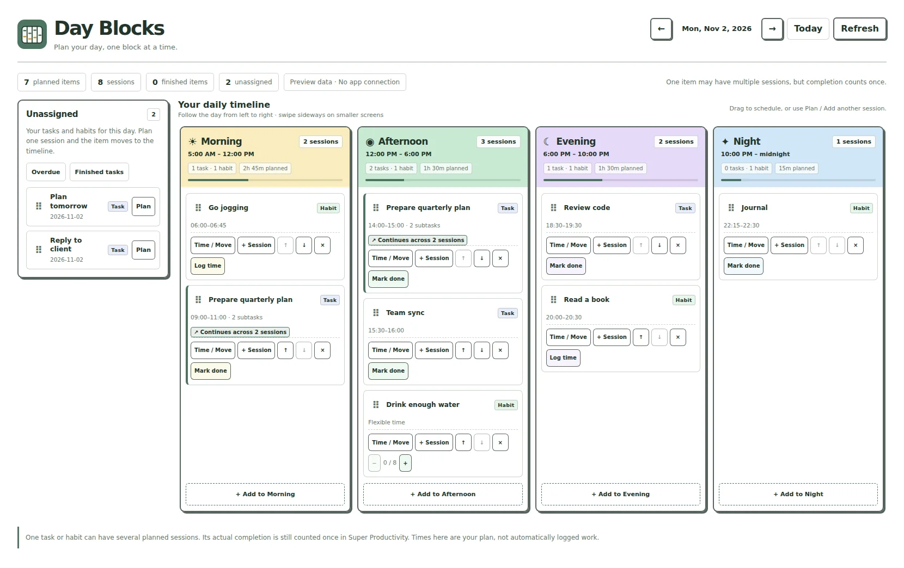
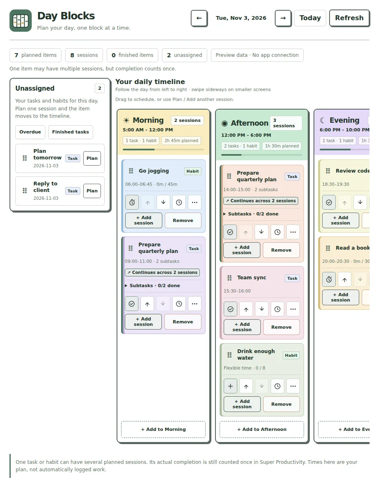
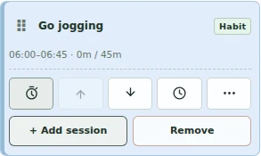
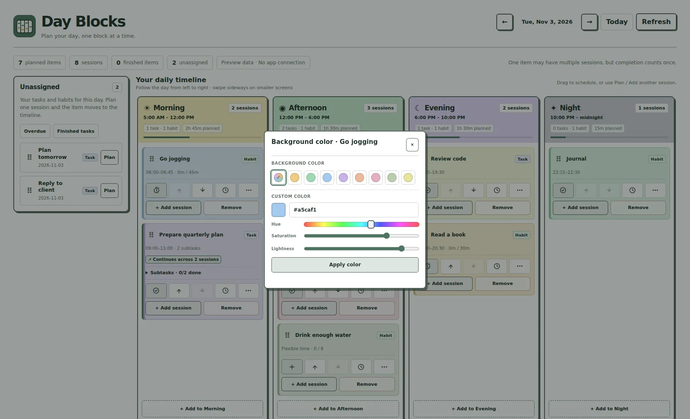
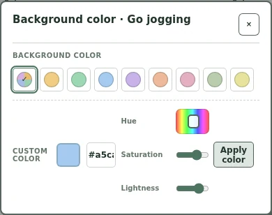
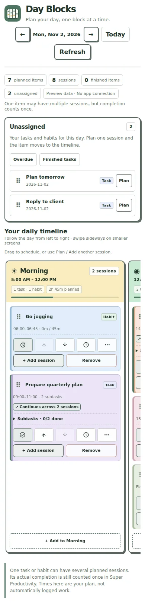
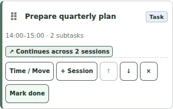
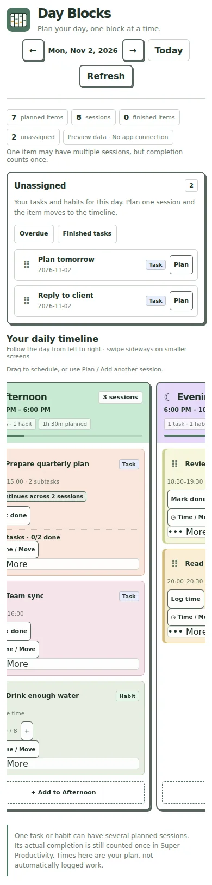
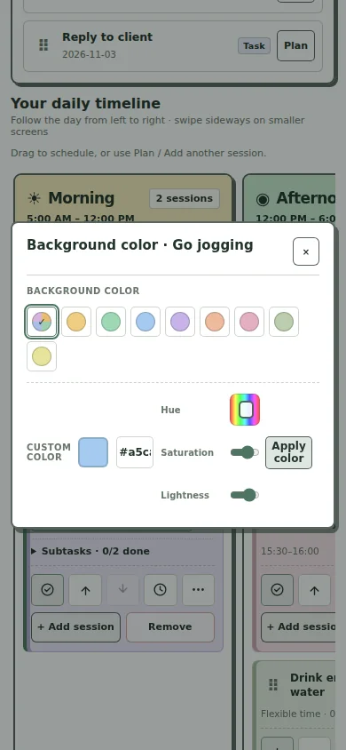
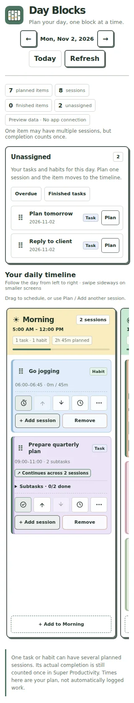

# Day Blocks

**Plan your day, one block at a time.**

Day Blocks is a Super Productivity companion that helps you decide **when** to work on today's tasks and habits. Keep your day simple: drag an item into Morning, Afternoon, Evening, or Night, then arrange the order that feels right to you.

> Day Blocks is a separate plugin from [Today+](https://github.com/phuongtt2a/super-productivity-today-plus). They work independently, and you can keep using either or both.

## Your day at a glance

### Keep your timeline while editing a task

Click a task title to open its details in Super Productivity. If the details panel makes Day Blocks narrower, **Unassigned stays beside the timeline** and all four blocks remain in chronological order. Scroll the blocks sideways when needed.

### Simpler session controls

### A color popup you can always close

See the phone layout and a task continuing into another block

## Make space for what matters

- **Four blocks, one day.** Follow Morning (5 AM–noon), Afternoon (noon–6 PM), Evening (6–10 PM), and the slate-gray Night (10 PM–midnight) from left to right.
- **Open task details.** Click or tap a task title in Unassigned or on the timeline to edit the original task in Super Productivity. Subtask titles open their own details too.
- **Tasks and habits together.** Find today's items in **Unassigned**. Move them into a block with a drag or the **Plan** button. Expand a planned task to see and complete its subtasks.
- **Clear, one-line controls.** Five compact icons for Done (or habit progress), Move up, Move down, Time / Move, and More. Beneath them, two balanced buttons let you **Add session** or **Remove** a planned session quickly. **More** opens a centered popup just for personalizing its color.
- **Make colors yours.** Each session has a soft background by default. Pick a preset, or create a custom color inside the popup using simple color sliders or a hex code. No separate system color picker is required. **Apply color** saves your selection and closes the popup immediately. The color belongs to that individual session.
- **Choose your order.** Drag planned sessions to another position, or use the visible up/down arrows on each card.
- **Plan the time you need.** Leave a session flexible, give it a planned duration, or choose an exact start and end time within its block.
- **Continue in another block.** Use **+ Add session** when one task or habit needs more than one part of the day. The linked cards still represent the same original item.
- **Keep a daily habit routine.** Choose **Repeat this habit session on future scheduled days** when planning a habit you want to do regularly.
- **Stay in charge of progress.** Mark tasks done, update habit counters, or add time you've already spent on stopwatch habits. Scheduling never marks an item completed.
- **Keep tomorrow flexible.** Go to the previous or next day to plan ahead, while repeating habits follow their existing scheduled days.

An item disappears from **Unassigned** after you plan its first session. You can add further sessions without creating duplicate tasks or habits. Removing all of today's sessions returns it to Unassigned.

## On your phone

The four time blocks **remain in one horizontal row**, just like a timeline. Swipe sideways to move through the day. **Plan**, the clock icon, and up/down arrows work without dragging.

## Install Day Blocks

**Latest development preview: v0.1.1-beta.6 — not yet merged or published as a GitHub Release.**

1. Open the successful [preview build for the task-details layout fix](https://github.com/phuongtt2a/super-productivity-day-blocks/actions/workflows/check.yml).
2. Download the `day-blocks-preview` artifact, extract the outer artifact ZIP, and locate `dist/day-blocks-super-productivity.zip`.
3. In Super Productivity, open **Settings → Plugins → Choose Plugin File** and install the *inner* plugin ZIP directly.
4. Open **Day Blocks**, try clicking a task title, and set a custom session color. **Apply color** should immediately close the popup.

The previously published [v0.1.1-beta.3 pre-release](https://github.com/phuongtt2a/super-productivity-day-blocks/releases/tag/v0.1.1-beta.3) remains available. This newer build will not replace it until tested and approved.

## A few things to know

Day Blocks plans your time; it is **not a second timer or calendar**. Planning 45 minutes does not log 45 minutes of completed work. A habit's daily goal and actual progress still belong to Super Productivity. Actual progress controls are enabled when viewing Today; planning past or future days doesn't secretly change today's habit values.

A task appearing in Morning and Afternoon is **one task with two planned sessions**. Finishing it updates both cards. Tasks and habits you've deleted in Super Productivity can be removed from the plan.

Routine planning actions quietly update the board. If something fails, Day Blocks briefly shows an explanation rather than leaving a permanent notification at the bottom. The color popup stays open during automatic task updates until you close it.

You can keep using Today+ v2.0.0 exactly as before. Day Blocks doesn't modify its layout, preferences, or plugin release.

---

**Simple planning, a calmer day.**

[Release history](CHANGELOG.md) · [Testing notes](docs/QUALITY.md)
